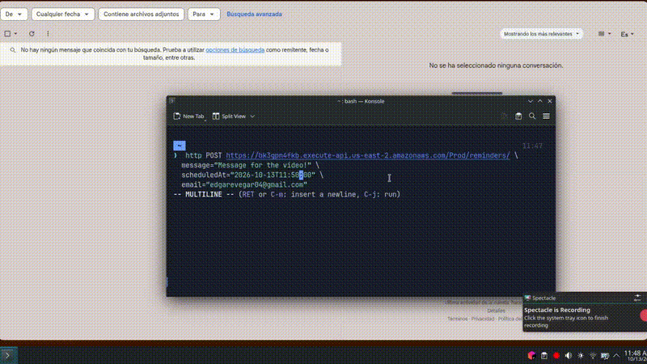
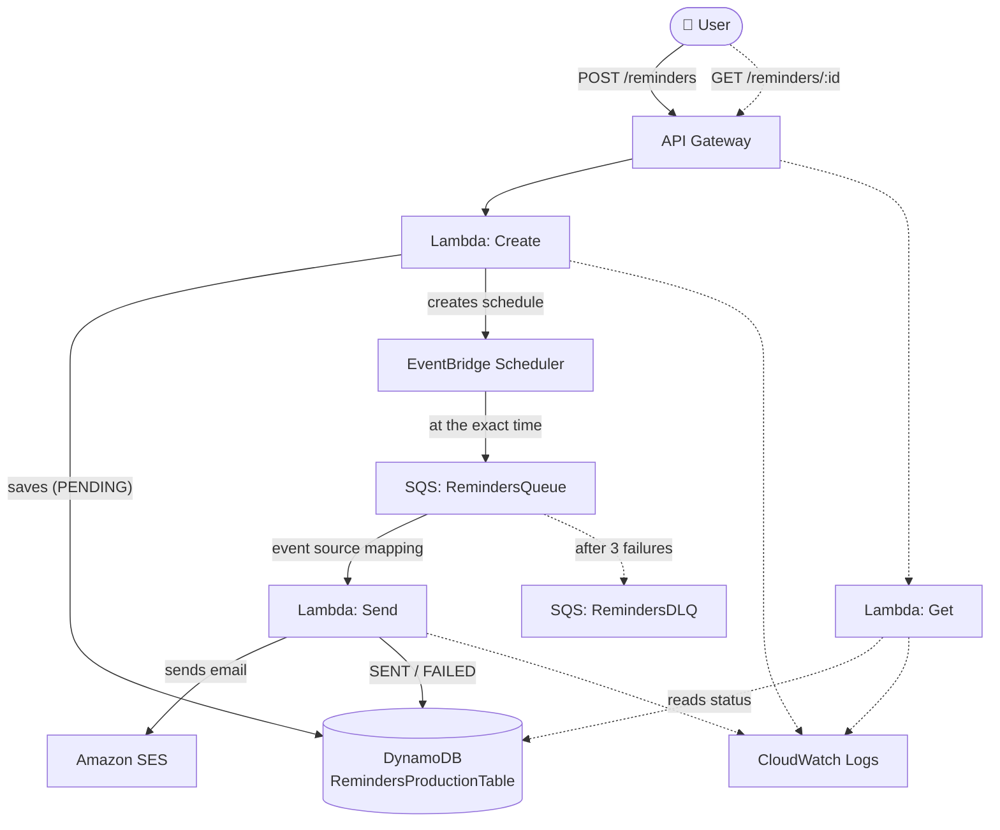

# Deferred Reminders System

A serverless AWS application: a user creates a reminder with a message and a future date/time; the system stores it, waits until that moment, and sends an email notification. The reminder's status (`PENDING` → `SENT` / `FAILED`) can be queried at any time through the API.

Infrastructure as code with **AWS SAM** (`template.yaml`), Node.js 22.

## Demo



## Architecture



## Flow

1. `POST /reminders` → **Create** validates the request, stores the reminder as `PENDING`, and creates a schedule in EventBridge Scheduler.
2. At the given date/time, Scheduler drops a message into `RemindersQueue`.
3. The **Send** Lambda consumes the message, sends the email through SES, and updates the status to `SENT` (or `FAILED` with error details).
4. `GET /reminders/:id` returns the real status: it is the evidence that the flow worked, even if the email never reaches a verified inbox.

## API endpoints

### `POST /reminders`

Creates a reminder and schedules its delivery.

Request body:

| Field | Type | Required | Description |
| --- | --- | --- | --- |
| `message` | string | yes | Reminder text (email body). |
| `scheduledAt` | string | yes | Delivery date/time in the `timezone`'s zone, format `yyyy-mm-ddThh:mm:ss` (no `Z`). |
| `email` | string | yes | Recipient address. |
| `timezone` | string | no | IANA time zone (e.g. `America/Mexico_City`). Defaults to the `DEFAULT_TIMEZONE` environment variable (`America/Phoenix`). |

Example request:

```json
{
  "message": "Buy milk",
  "scheduledAt": "2026-10-13T15:00:00",
  "email": "someone@example.com",
  "timezone": "America/Mexico_City"
}
```

Response `201`:

```json
{
  "id": "396fb89b-ebeb-4e0d-b7ec-5644dcd1bdf6",
  "message": "Buy milk",
  "scheduledAt": "2026-10-13T15:00:00",
  "email": "someone@example.com",
  "timezone": "America/Mexico_City",
  "status": "PENDING"
}
```

Errors: `400` if `message`, `scheduledAt`, or `email` is missing, or if `timezone` is not a valid IANA zone.

### `GET /reminders/{id}`

Returns the reminder by `id` (same fields as when created). Returns `404` if it does not exist.

`status` is one of `PENDING`, `SENT`, or `FAILED`.

## Components

| Component | Role |
| --- | --- |
| **API Gateway** | Exposes `POST /reminders` and `GET /reminders/{id}` (implicit API generated by SAM, stage `Prod`). |
| **Lambda Create** | Validates the request, writes to DynamoDB, and creates the schedule. |
| **Lambda Send** | Triggered by SQS (`BatchSize: 1`). Calls SES and updates the status; on failure it rethrows the error so SQS retries. |
| **Lambda Get** | Reads a reminder by `id`. Read-only permissions. |
| **DynamoDB** | `RemindersProductionTable` (key `id`, `PAY_PER_REQUEST`). |
| **EventBridge Scheduler** | Fires at the exact date/time with no horizon limit (days, months). Uses the `SchedulerToSqsRole` role. |
| **SQS + DLQ** | `RemindersQueue` receives the trigger; after 3 failed attempts (`maxReceiveCount: 3`) the message moves to `RemindersDLQ`. |
| **SES** | Sends the email. While in sandbox, sender and recipients must be verified. |
| **CloudWatch Logs** | JSON logs for every step (creation, sending, SES `MessageId`). |

Each Lambda has least-privilege IAM permissions: Create writes to DynamoDB and creates schedules; Send reads the queue, writes to DynamoDB, and uses `ses:SendEmail`; Get is read-only.

## About SQS: optional, but included on purpose

For this project's volume, **SQS is not necessary**. EventBridge Scheduler already provides its own retries and DLQ and can invoke the Send Lambda directly (Scheduler → Lambda). Since this is a practice project, I decided to add it to implement and understand the **Scheduler → SQS → Lambda** pattern.

What it brings to this design:

- **Retries and DLQ**: a failure in SES or DynamoDB doesn't lose the reminder; failed messages stay in the DLQ to be inspected and redriven.
- **Burst buffering**: if many reminders fall on the same minute, the queue holds them and the Lambda processes them at its own pace.
- **Concurrency control**: lets you cap simultaneous invocations, useful given SES sending limits.

How it works: Lambda continuously polls the queue (*event source mapping*) and does not wait to accumulate messages. With `BatchSize: 1`, each message triggers an almost immediate invocation. If the handler finishes without error, the message is deleted; if it throws, the message reappears after the *visibility timeout* and is retried. Standard SQS is **at-least-once**, so the same message may occasionally be processed more than once.

## Deployment

```bash
sam build
sam deploy --guided
```

Before testing end to end, verify the sender and test recipients under **SES → Verified identities**. To send to any address, request SES *production access*.

## Local testing

`sam local invoke` with `local-env.json` pointing to DynamoDB Local (Docker). EventBridge Scheduler and SQS have no local equivalent, so that part is tested against real deployed resources.

## Costs

Everything stays within the AWS free tier for a portfolio project: no NAT Gateway, RDS, or EC2 running 24/7.